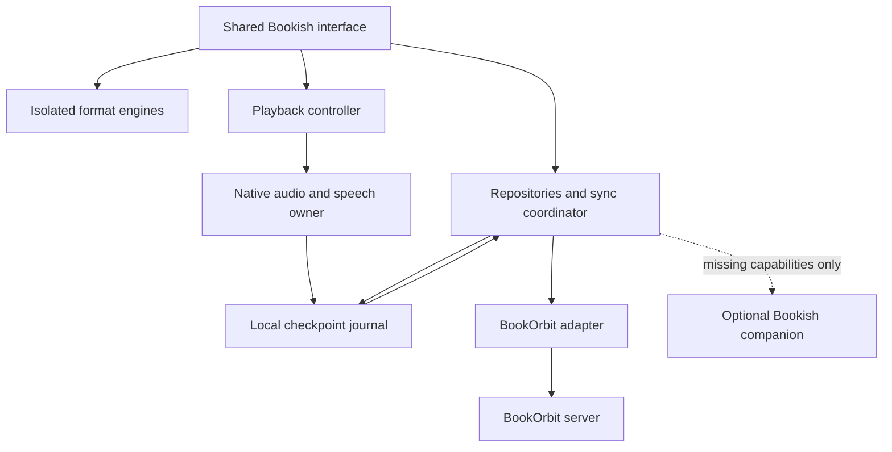

# Avid research baseline

> **Historical planning record — superseded phase numbers and product direction.** The [current Avid roadmap](roadmap.md), updated October 10, 2026, governs delivery: Phase 2 is complete audiobook functionality (formerly Phase 3); Phase 3 is full offline support (formerly Phase 2, requirements F67–F71); Phase 4 is Apple Pencil and reader enhancements; Phase 5 is UI enhancements; Phase 6 is reference/branding cleanup, README/docs and launch. The provisional Bookish name, redesign direction and original phase labels below are retained as historical evidence, not current instructions. The app is Avid; the user's subsequent replica request superseded the original redesign direction. Phase 6 will convert retained requirements into Avid-owned documentation and remove Apogee mentions from release content.

Source: https://chatgpt.com/space/page_58b3bd60415c8191802c068b75aef6f6

Bookish will be a redesigned client for a self-hosted BookOrbit library, with shared product behavior across iOS, Android, macOS, Windows, Linux, and the web. Start with the online reading and listening experience, then complete offline parity, then add audiobook improvements.

The recommended architecture is **React and TypeScript for the shared interface and reader, Capacitor for mobile, and Tauri for desktop**, with native mobile playback services. Keep BookOrbit as the owner of the library and existing reading data. Add a small optional Bookish companion only where a required capability cannot be represented in the verified BookOrbit API.

**Planning date:** October 9, 2026. **Product name:** Bookish, provisional. **Deliverable:** implementation scope, technology decisions, redesigned interface direction, and a feature-by-feature acceptance map. This is a planning baseline; implementation is a separate task.

## Baseline and release scope

Use **Apogee Reader 1.1.0** as the public feature baseline. Its App Store description and release notes supply the feature names in the map below. The implementation and acceptance columns specify proposed Bookish behavior. The map is an advertised-feature inventory, not a completed hands-on behavioral audit. [Apogee listing](https://apps.apple.com/us/app/apogee-reader/id6779567734)

There are **71 mapped requirements: 66 for Phase 1 and five explicitly deferred offline requirements for Phase 2**. OS-specific features apply to the relevant native platform; other platforms receive the equivalents defined in the support matrix. Phase 1 must be described as online functional parity with declared exceptions. Complete offline parity arrives in Phase 2.

| Release | Outcome | Scope boundary |
| --- | --- | --- |
| Phase 0 | Prove the integration and runtime choices | Audit the installed app, pin server contracts, and test the hardest platform behavior before broad UI work. |
| Phase 1 | Online Apogee functionality with a redesigned interface | All P1 requirements, applicable native integrations, BookOrbit connection, synchronized reading and listening for already aligned material. |
| Phase 2 | Full offline operation | All P2 requirements, durable media downloads, catalog access, local search, edit queues, and conflict recovery. |
| Phase 3 | Audiobook enhancements | Smarter playback, transcripts, generated alignment, chapter tools, and optional casting or wearable companions. |

Certify the first integration against **BookOrbit 3.3.0**, the release listed on October 7, 2026. Use the release tag and recorded API schemas rather than treating the moving main branch as a permanent contract. Decide support for older servers after the compatibility spike. [BookOrbit releases](https://github.com/bookorbit/bookorbit/releases)

Existing alignment belongs in Phase 1. BookOrbit documents EPUB3 media overlays and an optional bridge to matching standalone audio; the bridge uses real locators and timing data. Its documented duration tolerance is the smaller of five percent or five minutes. A plain ebook and audiobook do not supply sentence timing just because their titles match. Creating new alignment belongs in Phase 3. [Read-along integration](https://bookorbit.app/storyteller-read-aloud/)

Use original Bookish branding and interface code. No Apogee code reuse is assumed. BookOrbit server administration, metadata-provider configuration, book requests, and its official watch app are separate from this Apogee baseline. Keep the server's existing downstream integrations working through its normal data contracts.

## Technology decisions

| Area | Selected approach | Reason and implementation condition |
| --- | --- | --- |
| Shared product interface | React, TypeScript, Vite, responsive CSS tokens | One UI and reader codebase across web-based shells. Use a static client build; server rendering adds little to a private reader. |
| Mobile shell | Capacitor 8, Swift plugins on iOS, Kotlin plugins on Android | Reuse the interface while implementing audio, speech, widgets, intents, files, and secure credentials natively. |
| Desktop shell | Tauri 2 | Package the shared interface for macOS, Windows, and Linux. Use explicit platform adapters for media keys, files, and OS credentials. |
| Browser delivery | The same Vite client as a PWA | Installable browser experience. Serve alongside BookOrbit or through a narrowly scoped same-origin proxy where CORS is not configured. |
| Ebook engine | Foliate.js behind a Bookish ReaderEngine interface | Supports the required EPUB and MOBI families and locator operations. Pin a tested commit: upstream explicitly describes its API as unstable. |
| PDF engine | A separate PDF.js adapter | Avoid depending on Foliate's experimental PDF integration. Implement cropping, page state, and overlays in this adapter. |
| Comic decoding | ZIP loader plus native libarchive wrappers; separately built WASM fallback for browsers | Reuse a ComicAssetSource interface. Prove RAR and 7-Zip fixtures early; libarchive documents RAR limitations. |
| iOS audio | AVPlayer or AVQueuePlayer, AVAudioSession, MediaPlayer integration | The native playback owner manages transport, timers, credentials for streaming, and checkpoints while the WebView is suspended. |
| Android audio | Media3 ExoPlayer with MediaLibraryService and MediaSession | One native service supplies background playback, notifications, external commands, and the library surface needed for car integration. |
| Desktop and browser audio | HTMLMediaElement behind the shared transport interface, plus native desktop media-control adapters | Sufficient for supported codecs while the app runs. Qualify codecs per engine; use a compatible derivative when needed. |
| Speech | AVSpeechSynthesizer on Apple platforms, Android TextToSpeech, platform adapters on desktop, browser speech as a limited fallback | Use installed voices. Word highlighting follows actual boundary events; do not simulate exact timing. |
| BookOrbit access | A typed BookOrbitAdapter with runtime response validation | Domain code uses ports such as LibraryRepository and ProgressSync, not raw server routes. Generate types from verified OpenAPI if available. |
| Online query state | TanStack Query | Cache and invalidate server reads. Persistent entities and mutation durability belong in the repository, not only in query memory. |
| UI and playback state | Small explicit state stores; a typed transport state machine | Distinguish loading, playing, paused, buffering, interrupted, stopped, and failed. The native player reports authoritative audio state. |
| Native local data | SQLite through shell-specific adapters | Define migrations and transactional writes from Phase 1, even before full offline features are exposed. |
| Browser local data | IndexedDB with Dexie | Implement the same repository semantics; add media storage and persistence handling in Phase 2. |
| Optional companion | TypeScript, Fastify, SQLite, one Docker service | Store timestamped audio notes or run opt-in connectors only if the server contract cannot support them. Reuse verified account identity or require explicit pairing. |
| Later media processing | FFmpeg plus a Python transcription/alignment worker | Keep expensive processing outside the client. Add jobs, cancellation, progress, and versioned outputs in Phase 3. |
| Validation and delivery | Vitest, Playwright, native device checks, CI builds for each OS | Test locator behavior, playback lifecycle, and server contracts; add screenshot checks for the redesigned interface. |

Capacitor exposes native APIs through plugins, while Tauri supports the required desktop platforms. These runtimes supply access to native code; neither supplies a finished audiobook service, widget system, or CarPlay experience for this product. [Capacitor](https://capacitorjs.com/docs) · [Plugin development](https://capacitorjs.com/docs/plugins/creating-plugins) · [Tauri](https://v2.tauri.app/)

Foliate is a rendering dependency, not the product interface. Keep it replaceable, pin it, and run fixtures before updates. Isolate book content, block book scripts and unexpected remote resources, and keep the native bridge unavailable to rendered book documents. [Foliate.js](https://github.com/johnfactotum/foliate-js) · [PDF.js](https://mozilla.github.io/pdf.js/) · [libarchive](https://github.com/libarchive/libarchive)

Android background playback belongs in a service rather than the UI lifecycle. Speech range events depend on the selected engine supplying timing. CarPlay adds an external entitlement dependency, so start that request during Phase 0. [Media3 background playback](https://developer.android.com/media/media3/session/background-playback) · [Android speech ranges](https://developer.android.com/reference/android/speech/tts/UtteranceProgressListener) · [CarPlay](https://developer.apple.com/carplay/)

### Alternatives considered

| Option | Strength | Tradeoff for Bookish | Decision |
| --- | --- | --- | --- |
| React Native and Expo | Native mobile UI and a familiar TypeScript stack | Still needs a DOM reader for ebooks and a separate desktop strategy; advanced audio and widgets need native work. | Choose if the project narrows to mobile and values a fully native UI over shared screens. |
| Flutter | Broad platform coverage and consistent UI rendering | HTML book rendering, text selection, and desktop WebView integration become a second integration layer. | Viable, but less direct for an EPUB-heavy product. |
| Tauri on every native platform | One shell family for mobile and desktop | Native audio services, app extensions, and intents still need implementation and device qualification. | Keep as a possible consolidation after it passes the mobile spike; do not make consolidation a prerequisite. |
| Separate SwiftUI and Compose apps | Strongest platform-specific control | Duplicates product UI and reader integration, plus requires a desktop/web strategy. | Reconsider only if measured reader or accessibility problems cannot be resolved in the shared interface. |

The recommendation is an engineering tradeoff, not a claim that shared web UI is automatically faster. The release gates below require measurements on the actual shells.

## Architecture and data ownership

Bookish talks directly to BookOrbit for supported library, file, annotation, progress, and reading-log operations. It does not create a second catalog server. OS integrations and the rendering engines sit behind narrow interfaces so platform work does not leak into every screen.

The diagram describes control and state boundaries. Book and audio bytes normally travel from BookOrbit to the format or playback backend, using its verified authentication and streaming contract. The companion should not sit in the ordinary media path.

| Data | Authoritative owner | Bookish responsibility |
| --- | --- | --- |
| Libraries, book metadata, files, permissions, collections | BookOrbit | Keep a scoped cache and obey server permission checks. |
| Server-supported progress, reading sessions, ebook annotations | BookOrbit after acknowledged writes | Maintain local checkpoints and track unacknowledged operations. |
| Playback currently in progress | Native playback service on mobile; active playback backend elsewhere | Report snapshots to the UI and persist checkpoints independently of it. |
| Reader preferences | Server where compatible; device override where platform-specific | Patch changed fields rather than overwriting a complete settings record. |
| Audio notes not representable in the server API | Optional companion | Store stable timestamp anchors and synchronize across platforms. |
| AO3 sessions | The explicitly enabled connector | Keep credentials/session state separate from BookOrbit authentication. |
| Downloaded bytes and offline indexes | Local device in Phase 2 | Verify, pin, evict, and reconcile without changing server file identities. |

BookOrbit already provides per-user data and bidirectional device sync. Preserve its file identities and locators. A displayed percentage is a summary, not a sufficient restoration anchor. [BookOrbit](https://github.com/bookorbit/bookorbit) · [KOReader sync](https://bookorbit.app/koreader/)

### Repository layout

Use a pnpm workspace with apps for the shared web client, mobile shell, and desktop shell. Keep packages for UI tokens, domain models, the BookOrbit adapter, reader engines, playback contracts, repositories, synchronization, and fixture data. Put Swift and Kotlin implementation beside the mobile plugins. Add the companion app only when Phase 0 establishes a need.

The shared contracts should cover BookIdentity, FileIdentity, ReadingAnchor, AudioAnchor, Annotation, ReadingSession, ReaderPreferences, ServerCapabilities, and SyncOperation. Native plugins exchange serializable snapshots and commands, not DOM nodes or React state.

### Local records needed from the start

| Record | Important fields | Purpose |
| --- | --- | --- |
| ServerProfile | Profile identity, normalized base URL, observed version, capability snapshot | Route actions and validate compatibility. |
| AccountScope | Server identity, user identity, permissions reference | Prevent cache and queue leakage between accounts. |
| Book and BookFile | Server IDs, format, content fingerprint, observed revision or modification value | Match the correct edition and invalidate stale anchors. |
| ReadingAnchor | File ID, locator kind, locator payload, quoted context when relevant, source event time | Restore EPUB, PDF, comics, and speech independently of layout. |
| AudioAnchor | File or track ID, track-relative milliseconds, timeline version, source event time | Avoid confusing a whole-book timestamp with a track position. |
| Annotation | Server/local ID, text or audio anchor, quote, note, revision if available, deletion state | Preserve edits and prevent deleted notes from returning. |
| ReadingSession | Local operation ID, source device, activity type, start/end, active duration, anchor range | Make session reporting auditable and retryable. |
| OutboxOperation | Local UUID, scope, entity, payload, original event time, retry state | Recover transient write failures in Phase 1 and expand offline writes in Phase 2. |
| DownloadManifest | File identity, content version, assets, checksums, byte ranges, pin state | Reserved now and implemented fully in Phase 2. |

These are proposed internal records, not claims about BookOrbit's database schema. Do not assume its API exposes revisions, idempotency keys, or a change feed. Adapt to the observed contract and record the weaker guarantees when one is absent.

## BookOrbit integration contracts

Confirm route names and payloads against the pinned server during Phase 0. The following are client responsibilities and discovery targets; they are not invented API endpoints.

| Client port | Contract to establish | Verification |
| --- | --- | --- |
| Authentication | Local login, refresh/session behavior, provider discovery, native sign-in callback | Password login and OIDC return on physical iOS/Android devices; token expiry during playback. |
| Catalog | Libraries, paginated book lists, search/filter behavior, series, collections, permissions | Large-library fixtures, restricted accounts, cancellation, and pagination consistency. |
| File access | Files and covers, download/stream auth, ranges, content types, stable IDs | Seek into a long audiobook, open a large archive, and repeat behind a reverse proxy. |
| Progress | Format locators, fingerprints, timestamps, read status, translation semantics | Bookish to web reader to KOReader round trips and a deliberate older update. |
| Annotations | Create/edit/delete, search, anchors, identity, soft-deletion or revision behavior | Edits and deletions across two Bookish clients and the server reader. |
| Activity | Reading-log writes/reads, source labels, supported activity types, stats units | Compare active time, pauses, and reading/listening/speech totals with server fixtures. |
| Preferences | Global defaults, per-file overrides, partial updates | Two clients changing different settings without overwriting each other. |
| Read and Listen | Media-overlay discovery, resource/timing access, optional audio bridge, incompatible-edition status | Aligned EPUB, matching standalone audio, missing duration, and mismatched editions. |
| Uploads | Allowed destinations, accepted formats, upload limits, processing status, deduplication | Upload one file and a small batch, including a failure and a restricted account. |
| Audio notes | Whether timestamped audio annotations can be represented and synced | Prove the complete write/read/edit/delete cycle; otherwise activate the companion design. |

OIDC must follow BookOrbit's server flow. Its documentation describes provider buttons, a return to BookOrbit, and PKCE. This does not by itself establish a supported native-app token handoff; verify that handoff before designing the login screen around it. Never put an identity-provider client secret in Bookish. [OIDC](https://bookorbit.app/oidc/)

A web deployment must handle CORS, secure origins, cookie rules, and media authentication. Prefer a same-origin deployment. A browser cannot use an arbitrary Authorization header on every media-element request; verify the server's supported mechanism. Do not assume that signed media URLs or token exchange exist.

BookOrbit remains responsible for device integrations such as Kobo and existing external annotation exporters. Bookish should write compatible server data rather than implementing independent copies of those services. [Annotations](https://bookorbit.app/annotations/) · [Book details and files](https://bookorbit.app/book-details/) · [Reader preferences](https://bookorbit.app/reader/)

### Synchronization rules

1. Persist a checkpoint locally before sending it. On mobile, the native player also persists when the WebView is suspended.

2. Preserve the source event time when retrying. Fetch the server's current state before replaying an older local mutation.

3. Use server ordering/version rules where available. When the server lacks a guarded write, avoid replaying a demonstrably stale event and disclose any remaining race.

4. Do not choose the largest percentage as the universal winner. Re-reading and deliberate backward seeks are valid.

5. Restore exact native locators when available. Preserve quote/context fallbacks and mark approximate translations.

6. Keep annotation deletion state until synchronization acknowledges it. Use server identities to avoid duplicate imports.

7. Use deterministic local operation IDs. If the server cannot deduplicate session writes, reconcile uncertain writes before retrying; do not claim exactly-once delivery.

8. Expose a small sync status and a recovery view with local/server positions when an unresolved conflict affects resumption.

KOReader translations can be approximate in one direction, and BookOrbit documents file-fingerprint matching and timestamp-based canonical progress. Set a same-file exactness gate and a separate documented tolerance for cross-reader translations. [KOReader behavior](https://bookorbit.app/koreader/)

## Redesigned interface

Use a calm library aesthetic: warm paper surfaces, dark ink, one restrained teal accent, generous cover spacing, and a dark palette designed independently. Use a system sans face for navigation and user-selected typography for reading. Keep book covers and the current activity prominent. Avoid copying Apogee's visual assets or layouts.

On phones, use **Home, Library, Search, Notebook, and More** as the bottom navigation. More contains Activity, integrations, and Settings. A persistent mini-player sits above navigation whenever playback is active. On tablets and desktop, move navigation to a sidebar and use a list/detail split view. The reader keeps its own focused layout.

| Screen | Primary behavior | Design direction |
| --- | --- | --- |
| Connect | Add server, test connectivity, choose login | One clear setup flow with actionable version and authentication errors. |
| Home | Resume the current activity and browse recent shelves | A single prominent Continue action; separate reading and audio indicators when needed. |
| Library | Browse formats, series, and collections | Virtualized grid/list, persistent filter state, clear cover badges, and fast keyboard access. |
| Search | Find titles, people, and relevant annotations | Group results by type; retain scope and recent searches locally. |
| Book details | Choose Read, Listen, or an available linked mode | Show editions/files, alignment readiness, progress, series, and a compact notes preview. |
| Reader | Read with typography and navigation controls | Tap to reveal a slim toolbar; place appearance and contents in sheets or side panels. |
| Player | Listen with reliable transport | Large chapter/title area, a chapter-relative timeline, distinct whole-book progress, and reachable speed/timer controls. |
| Read and Listen | Follow narration in the book | Keep audio controls compact and make Follow text an explicit toggle. |
| Notebook | Find highlights, text notes, and audio notes | One searchable workspace with format-specific anchors and jump-to-source actions. |
| Activity | Review reading and listening time | Separate activity types, account timezone, accessible chart summaries, and server-consistent totals. |
| Integrations | Manage AO3 and e-ink delivery | Clear connection state, manual retry, last successful action, and account-specific settings. |
| Offline management in Phase 2 | Pin and manage downloaded material | Show ready, partial, stale, failed, and needs-sync states, with storage and network policies. |

The same title can have portrait ebook artwork and square audiobook artwork. Use the appropriate server cover where supported rather than stretching one asset everywhere. [BookOrbit cover handling](https://bookorbit.app/book-details/)

Prototype the Connect, Home, Book details, Reader, and Player screens first. Validate three complete flows: connect and read, resume and listen, and switch from reading to already aligned narration. Add tablet and desktop states to those prototypes before implementing the whole navigation.

Every control must have a label and a keyboard/focus behavior. Preserve the logical reading anchor across text-size, layout, orientation, and pane changes. Keep selection tools usable with screen readers. Measure these properties on the actual WebViews, not only in a desktop browser.

## One to one feature map

**P1** means the first online release; **P2** means the offline release. A platform or capability suffix declares where an item is applicable. Every requirement stays in the release checklist until its proposed acceptance test passes.

The baseline labels below come from the [Apogee description and version history](https://apps.apple.com/us/app/apogee-reader/id6779567734). Bookish implementation details and tests are proposed requirements, not assertions about Apogee's internal code or undocumented behavior. Phase 0 must add any further settings or workflows found in the hands-on audit.

### Connection and library

| ID | Apogee feature | Bookish implementation | Proposed acceptance test | Release |
| --- | --- | --- | --- | --- |
| F01 | BookOrbit | Connect directly to the configured server through a versioned adapter. | List accessible libraries without a Bookish cloud account. | P1 |
| F02 | Password login | Use the server login and refresh contract; keep credentials in OS storage. | Login, expire the session, refresh, and sign out cleanly. | P1 |
| F03 | Provider login | Open the server OIDC flow in a system browser and handle the verified callback. | Complete login with an enabled provider and an existing account. | P1 |
| F04 | Home Library Browse | Build virtualized shelves, paginated lists, cached covers, and cancellable requests. | Browse a 10,000-book fixture without loading its entire catalog. | P1 |
| F05 | Series | Group editions by server series identifiers and preserve sequence ordering. | Open a series and select the correct volume. | P1 |
| F06 | Collections | Expose server collections with permission-aware membership actions. | Change membership and confirm the same result on the server. | P1 |
| F07 | Manga filing | Provide configurable manga classification and direction rules. | A classified title opens with the saved right-to-left preference. | P1 |

### Ebooks PDF and comics

| ID | Apogee feature | Bookish implementation | Proposed acceptance test | Release |
| --- | --- | --- | --- | --- |
| F08 | EPUB | Use the isolated Foliate adapter for reflowable and fixed-layout books. | Open fixtures and restore location after rotation and font changes. | P1 |
| F09 | MOBI | Use the MOBI parser behind the same reader interface. | Open representative DRM-free fixtures and preserve their file identity. | P1 |
| F10 | Fonts | Provide readable family, size, and typography controls. | Change typography without moving the logical reading anchor. | P1 |
| F11 | Themes | Use reader-specific light, warm, dark, and custom color settings. | Content and selection overlays remain readable in each theme. | P1 |
| F12 | Margins | Expose reader spacing controls independent of library layout. | Adjust margins and retain the same passage. | P1 |
| F13 | Page flow | Support paginated and continuous modes through the reader adapter. | Switch mode and reopen at the same logical location. | P1 |
| F14 | Font import | Import font files, validate them, and store them per account/device. | Use an imported font after restarting the app. | P1 |
| F15 | Turn animations | Offer None, Slide, Fade, and Fast Fade with a reduced-motion override. | Change effects without losing selection, position, or gestures. | P1 |
| F16 | PDF | Use a dedicated PDF.js viewer with bounded page rendering. | Navigate large documents without keeping every page canvas alive. | P1 |
| F17 | PDF cropping | Detect page content bounds; offer a manual adjustment and reset. | Trim margins while preserving annotations in original page coordinates. | P1 |
| F18 | CBZ | Decode ZIP entries through the comic asset loader. | Open an archive and show pages in deterministic order. | P1 |
| F19 | CBR | Decode supported RAR variants with libarchive; report unsupported variants explicitly. | Pass the agreed RAR fixture set on every target shell. | P1 |
| F20 | CB7 | Decode 7-Zip entries with the same archive interface. | Read a large archive without unbounded memory growth. | P1 |
| F21 | Paged comics | Build a paged viewer with directional navigation and image prefetch. | Resume the saved page in both reading directions. | P1 |
| F22 | Webtoon | Use a virtualized continuous image list with stable scroll anchors. | Reopen at the same image and within-image offset. | P1 |
| F23 | Two-page comics | Show configurable spreads on tablets and desktop windows. | Handle a cover page and odd page counts correctly. | P1 |

### Audio and speech

| ID | Apogee feature | Bookish implementation | Proposed acceptance test | Release |
| --- | --- | --- | --- | --- |
| F24 | Audiobooks | Use a shared transport model with platform playback backends and a codec resolver. | Play agreed formats, seek, cross tracks, and survive UI suspension on mobile. | P1 |
| F25 | Chapters | Normalize server chapter/track data into one ordered timeline. | Seek to each chapter and restore the exact track-relative timestamp. | P1 |
| F26 | Playback speed | Expose pitch-preserving rate controls and persist the preferred speed. | Change speed during playback without resetting the timeline. | P1 |
| F27 | Sleep timer | Run the timer in the playback owner; support duration and chapter-end stops. | Stop at the deadline with the screen locked. | P1 |
| F28 | CarPlay | Build native browsing and transport templates; request the audio entitlement early. | Browse and play in the simulator and a real car after entitlement approval. | P1 iOS |
| F29 | Lock Screen | Publish title, artwork, chapter, elapsed time, and transport commands. | Control playback while the app interface is suspended. | P1 native |
| F30 | Remote skipping | Route headset and car commands to the configured time or chapter policy. | Test forward/back actions over Bluetooth and wired controls. | P1 native |
| F31 | Read and Listen | Discover usable media overlays and compatible server audio bridges. | Offer linked mode only for a verified alignment. | P1 |
| F32 | Mode handoff | Resolve text and audio anchors through the alignment map. | Switch modes in either direction without percentage-based guesses. | P1 |
| F33 | Sentence highlighting | Map native audio timestamps to text ranges and auto-follow the active sentence. | Keep highlighting aligned across speed changes and chapter transitions. | P1 |
| F34 | Speak | Use installed system voices through a speech backend. | Start speech at the selection and expose available voices. | P1 |
| F35 | Word highlighting | Translate speech boundary callbacks into reader ranges. | Highlight spoken ranges where the selected engine exposes timing. | P1 capability |
| F36 | Speech page turns | Move the visible reader to the next spoken range. | Continue across pages and chapters without double-speaking text. | P1 |

### Progress notes and delivery

| ID | Apogee feature | Bookish implementation | Proposed acceptance test | Release |
| --- | --- | --- | --- | --- |
| F37 | Saved position | Persist format-specific checkpoints immediately in the local repository. | Restart after an interrupted session and recover the last checkpoint. | P1 |
| F38 | Progress sync | Send native locators and source timestamps through the server adapter. | Read on one Bookish device and resume on a second. | P1 |
| F39 | KOReader sync | Preserve file fingerprints and server locator translation behavior. | Round-trip fixtures through KOReader; identify approximate translations. | P1 |
| F40 | Reading log | Record active sessions with reading, listening, or speech activity types. | Confirm correct durations and types without counting pauses twice. | P1 |
| F41 | Reading Stats | Present the server reading log with activity filters and accessible charts. | Totals match server fixtures and use the account timezone. | P1 |
| F42 | Highlights | Anchor selections with precise locators and quoted context. | Reopen a selected passage after layout changes. | P1 |
| F43 | Notes | Attach editable notes to text or format-specific anchors. | Edit a note and reopen its associated passage. | P1 |
| F44 | Annotation search | Index/search quotes and note text with book filters. | Find a fixture phrase and open the matching annotation. | P1 |
| F45 | Annotation sync | Use server identities, revisions where available, and deletion state. | Edit and delete across devices without duplicate or resurrected annotations. | P1 |
| F46 | Audiobook notes | Keep timestamped notes; use BookOrbit if supported, otherwise the companion store. | Create on iOS and reopen at the same audio point on Android. | P1 conditional backend |
| F47 | File upload | Provide native file picking and a web upload flow to an allowed library. | Upload, report errors, and resolve the resulting server book/file identifiers. | P1 |
| F48 | CrossPoint delivery | Use firmware-verified multipart upload over native LAN networking; add discovery and an IP fallback. | Transfer a fixture to a physical CrossPoint and confirm it opens. | P1 native |
| F49 | Fanfic Updates | Use opt-in AO3 sessions, followed-work tracking, and controlled import updates. | Import one new chapter without duplicating the work or erasing its position. | P1 connector |

### System integration and accessibility

| ID | Apogee feature | Bookish implementation | Proposed acceptance test | Release |
| --- | --- | --- | --- | --- |
| F50 | Spotlight | Index permitted book metadata and deep links on Apple platforms. | An indexed result opens the intended server, account, and book. | P1 Apple |
| F51 | Continue widget | Expose a persisted recent-book snapshot to native widget extensions. | The widget displays the current item after app restart. | P1 mobile |
| F52 | Widget playback | Let the widget command the native playback owner directly. | Resume audio without requiring the main interface to open. | P1 capability |
| F53 | Quick actions | Publish recent-book and playback entry points through OS app actions. | Launch into the intended action from the app icon. | P1 mobile |
| F54 | System controls | Add iOS Control Center, Lock Screen control widgets, and Action button intents. | Invoke a saved playback action through each supported OS surface. | P1 iOS |
| F55 | Shortcuts | Expose stable playback and resume App Intents with account-safe identifiers. | Run an intent while the main interface is closed. | P1 iOS |
| F56 | iPad layouts | Design tablet panes, keyboard navigation, and reader panels; reuse on desktop. | Use portrait, landscape, split-screen, and keyboard-only navigation. | P1 |
| F57 | VoiceOver | Use semantic controls, reading order, labels, and focus restoration. | Complete login, reading, and playback with VoiceOver or TalkBack. | P1 |
| F58 | Dark interface | Use app-wide dark tokens independently from book themes. | Menus, sheets, and system bars remain consistent in dark mode. | P1 |
| F59 | Color independence | Add text or shapes to state and sync indicators. | Interpret every status without relying on hue. | P1 |
| F60 | Contrast | Define contrast-tested tokens for content, controls, and highlights. | Meet the chosen WCAG AA text and component criteria. | P1 |
| F61 | Reduced motion | Read OS motion preferences and provide an in-app override. | Disable movement without disabling reader navigation. | P1 |
| F62 | Localization | Keep all UI strings translatable; target en, fi, fr, de, pl, zh-Hans, and es. | Verify layouts and key flows in each target language. | P1 |
| F63 | Guides | Write task-oriented help for setup, formats, sync, audio, and recovery. | Each major feature has an accessible help entry. | P1 |
| F64 | No ads | Keep monetization surfaces out of the baseline product. | Release builds contain no advertising SDK or ad views. | P1 |
| F65 | No purchases | Deliver the baseline without feature-purchase dependencies. | All baseline functions work without an in-app purchase. | P1 |
| F66 | No tracking | Keep diagnostics local by default with an explicit export action. | A network audit finds only user-configured service traffic. | P1 |

### Offline features deliberately deferred

| ID | Apogee feature | Bookish implementation | Proposed acceptance test | Release |
| --- | --- | --- | --- | --- |
| F67 | Downloaded media | Pin complete, verified books and audio with a resumable native download manager. | Play/read pinned content after restart in airplane mode. | P2 |
| F68 | Offline library | Pin metadata, covers, file manifests, and relevant collection membership. | Browse the chosen offline catalog without server access. | P2 |
| F69 | Offline progress | Queue durable progress and session mutations with original event times. | Reconnect two independently used devices without silently losing either history. | P2 |
| F70 | Offline annotations | Store searchable notes/highlights locally with revision and deletion handling. | Create, edit, search, and delete offline; reconcile after reconnect. | P2 |
| F71 | Wi-Fi downloads | Add network policies, storage limits, retries, and explicit cellular overrides. | A large pinned download obeys policy changes and survives interruption. | P2 |

## Platform support

The objective is the same library and reading/listening workflows on six platforms, with native equivalents for OS integrations. A browser build is useful, but it cannot be the sole mobile audiobook product.

| Capability | iOS and iPadOS | Android | macOS Windows Linux | Browser |
| --- | --- | --- | --- | --- |
| Library and format readers | Required | Required | Required | Required after browser fixture checks |
| Continuous background audio | Native playback owner | Native playback service | While the installed app runs | Best effort; browser lifecycle applies |
| Lock-screen or system transport | Native | Native media session | Platform media-key adapters | Media Session where supported |
| Car interface | CarPlay, subject to entitlement | Android Auto equivalent through the media library | Not applicable | Not applicable |
| Current-book widgets | WidgetKit and App Intents | Native Android widgets | Tray/recent-book entry points; Apple search where available | In-app Continue action |
| OS book search | Core Spotlight | Shortcuts or search integration where the launcher supports it | Platform-specific indexing only where available | In-app search |
| Speak with installed voices | Native voices and boundary events | Native engine; boundary timing varies | OS speech adapter; Linux may need an installed speech service | Available browser voices with capability disclosure |
| LAN e-ink transfer | Native HTTP plus local-network permission | Native HTTP plus discovery/IP fallback | Native HTTP plus discovery/IP fallback | Direct LAN access depends on browser networking rules |
| Complete pinned offline library in P2 | Native app storage | Native app storage | Native app storage | Conditional on granted storage and persistence |
| AO3 account-based updates | Opt-in connector | Opt-in connector | Opt-in connector | Companion for protected cross-origin/session work |

Android Auto is the proposed equivalent for the iOS car workflow, not an additional claim about the Apogee baseline. Browser or OS limitations must remain visible in the release notes and capability screen. Do not silently count an unavailable OS integration as verified parity.

Use the CrossPoint firmware contract that matches the device. Current upstream documentation includes multipart file upload and discovery facilities, but the referenced branch is develop. Record the tested firmware version, handle existing-file replacement deliberately, and complete a real transfer before F48 passes. [CrossPoint endpoints](https://github.com/crosspoint-reader/crosspoint-reader/blob/develop/docs/webserver-endpoints.md)

Audio-note synchronization must work across Bookish platforms. Implement the shared outcome through BookOrbit or the companion instead of making iCloud the only data path. Existing Apogee audiobook-note migration needs an accessible export or a separately proven import route; do not assume that signing into the same Apple account exposes another app's private data. [Apogee data description](https://apps.apple.com/us/app/apogee-reader/id6779567734)

## Implementation sequence and estimates

Estimates assume one experienced engineer working full time, access to a Mac and physical mobile devices, and a test BookOrbit instance. They are planning ranges, not measured delivery commitments. The full Phase 1 scope is approximately **20 to 33 engineering weeks**. External store reviews and entitlement decisions can extend elapsed time.

Aim for a useful private alpha around **weeks 8 to 12**, covering connection, EPUB reading, MP3/M4B listening, and progress sync on iOS and Android. This alpha is a subset of the map. Continue building desktop and web from the same shared interface; keep the six-platform release gate for Phase 1.

| Milestone | Estimate | Deliverable | Exit gate |
| --- | --- | --- | --- |
| M0 Integration and runtime proof | 2 to 3 weeks | Audited baseline, pinned BookOrbit contracts, EPUB/audio prototypes, codec matrix, entitlement request | Demonstrate password/OIDC flow, 60-minute locked-screen audio, seek with authentication, and a locator round trip. Resolve the native callback and aligned-resource contract. |
| M1 Foundation and redesigned shell | 2 to 3 weeks | Workspace, adapters, repositories, navigation, account scoping, virtualized catalog | Connect a restricted account; render the large catalog; switch layouts without losing state. |
| M2 Readers and notebook | 3 to 5 weeks | EPUB/MOBI, PDF, comics, typography, annotation creation and sync | Format corpus passes; anchors survive layout changes; annotation edits/deletions round-trip. |
| M3 Native audio and speech | 4 to 6 weeks | Chapters, transport, speed, timer, background checkpoints, speech, audio-note storage route | Calls, headset removal, background playback, timer, session expiry, and playback restoration pass on physical devices. |
| M4 Linked reading and activity | 2 to 4 weeks | Media overlays, matching standalone audio bridge, KOReader compatibility, typed logs and stats | Read/listen handoff works on aligned fixtures; incompatible editions remain unlinked; totals match the server. |
| M5 Delivery and external connectors | 2 to 4 weeks | Uploads, CrossPoint transfer, AO3 updates, optional companion capabilities | A real e-ink transfer and one account-based chapter update succeed without duplicating a work. |
| M6 Native surfaces and desktop qualification | 3 to 5 weeks | Widgets, widget playback, Spotlight, quick actions, controls, Shortcuts, car interfaces, desktop integrations | Native actions invoke the playback owner; six-platform core checklist passes; entitlement status is recorded. |
| M7 Accessibility and release | 2 to 3 weeks | Localization, help, performance tuning, privacy audit, signed builds | All applicable P1 rows pass; exceptions are explicit; recoverable errors and upgrade behavior are verified. |

Start native playback and entitlement work in M0. Do not wait for a finished player screen to prove background behavior. The hardest integrations determine whether the chosen shell remains viable.

### Phase 0 evidence checklist

- Pin the installed Apogee and BookOrbit versions. Walk every visible screen and settings panel, recording actions, states, and expected outcomes in the feature tracker.

- Establish BookOrbit's actual authentication, locator, media-overlay, streaming, upload, and reading-log contracts. Capture sanitized fixture payloads.

- Test an aligned EPUB, its matching standalone audiobook, a plain compatible EPUB, and a mismatched edition. Keep file identities distinct.

- Prove native background playback and checkpoint persistence with network transitions and token expiry. Restart the interface while native audio continues.

- Prove text selection, custom fonts, and screen-reader operation on iOS WebKit and Android WebView.

- Open required comic archives on every decoding path. Record supported RAR variants and memory limits.

- Determine whether timestamped audio notes need the companion. Verify the identity/pairing contract before storing private user data.

- Test CrossPoint against a physical device and pin its firmware. Specify the AO3 followed-work/update semantics and how expiring sessions are recovered.

- Confirm the web deployment path, CORS, media authentication, and browser engine support. Select the initial minimum OS versions from this tested dependency matrix.

If the shared reader fails critical selection or accessibility gates, evaluate a native reader adapter before expanding UI work. If native audio cannot remain independent of the WebView, change the mobile integration before proceeding.

## Phase 2 full offline support

Build the durability primitives in Phase 1, but expose complete offline operation only after the content and synchronization guarantees pass. Temporary cached bytes are not the same as a verified downloaded book.

| Workstream | Implementation |
| --- | --- |
| Download manager | Resumable transfers, ordered priorities, Wi-Fi policy, disk-space checks, cancellation, retry/backoff, checksums, and atomic completion. |
| Complete publication manifests | Include every required EPUB asset, font, overlay timing file, narration segment, PDF byte dependency, or comic image. Mark partial downloads visibly. |
| Offline catalog and search | Pin the chosen metadata/covers/collection snapshot and searchable annotations. Record the snapshot version and make its scope clear. |
| Local media access | Resolve the same logical file identity to remote or verified local assets. Keep native streaming access independent of the React lifecycle. |
| Offline writes | Queue annotations, deletion state, positions, and activity with original timestamps. Keep local edits durable through process termination. |
| Conflict resolution | Pull changes before replay; apply server guards where available; retain unresolved positions and notes for user review. |
| Content updates | Detect replaced files and stale fingerprints. Download a new version separately and only replace a ready local copy after verification. |
| Storage management | Pin/unpin, quotas, least-recently-used eviction for unpinned assets, progress display, and account-specific cleanup. |
| Browser qualification | Use IndexedDB metadata and an appropriate media store; request persistence where available. Detect denied/quota-limited storage and avoid promising native-level durability. |

Offline readiness is a manifest-level state: **not downloaded, downloading, partial, verifying, ready, stale, or failed**. Sync readiness is separate: **synced, pending, conflicted, or failed**. A book can be ready to read while a new note is pending synchronization.

Required Phase 2 scenarios:

- Cold-start the native app in airplane mode and read/listen to every pinned format, including linked narration and installed-voice speech.

- Browse the pinned catalog; search existing notes; create/edit/delete annotations; persist reading and listening sessions.

- Kill and restart the app during a download and during offline editing. Recover without a corrupt ready state.

- Use two devices offline, including a deliberate backward seek and conflicting note edits. Reconnect in both orders and inspect reconciliation.

- Replace a server file while another device has the previous version pinned. Preserve old anchors and identify the edition change.

- Exercise low disk space, a denied browser persistence request, logout/account switching, and a revoked server session. Do not erase unsynchronized edits merely because a refresh request failed.

Plan approximately **6 to 10 additional engineering weeks** after Phase 1, adjusted once server conflict and download contracts are proven.

## Phase 3 audiobook enhancements

Keep this backlog separate from Apogee parity so later improvements do not delay the first usable client. Sequence the first two batches before optional ecosystem expansion.

| Batch | Enhancement | Dependency and acceptance |
| --- | --- | --- |
| A Playback quality | Smart rewind based on pause duration, listening history, configurable skips, robust bookmarks, a queue, and richer sleep behavior | Preserve raw source positions and session totals. Test interruption and chapter boundaries on physical devices. |
| A Audio processing | Optional silence skipping, voice boost, loudness normalization, and fine speed presets | Build on a DSP-capable backend; verify timing translations and never reuse an unadjusted playback clock. |
| B Transcripts | Searchable timestamped transcripts and tap-to-seek | Run versioned background jobs; link every result to the source file and track timing. |
| B Generated alignment | Transcript/forced-alignment pipeline and optional Storyteller-compatible EPUB output | Validate edition/chapter matching, timing quality, cancellation, and repeatable job outputs. Do not auto-link uncertain pairs. |
| B Chapter tools | Correct chapter names and boundaries; import/export chapter metadata | Keep an original timeline and an explicit edited view; verify positions after updates. |
| C Audio learning tools | Export audio notes and transcript highlights to portable formats or configured services | Use stable anchors and preserve account permissions. |
| C Devices | Casting, phone-free wearables, and expanded e-ink workflows | Each integration gets its own background, offline, battery, and permission gates. |
| C Local narration | Optional improved self-hosted or downloaded voices | Establish voice licensing, model storage, privacy behavior, and device performance before release. |

For generated alignment, start with one known edition and recording. Produce a versioned map from text locators to audio intervals, with confidence and source fingerprints. Evaluate sentence timing on hand-labeled samples before enabling automatic handoff. This adds new data preparation capability; it does not replace the Phase 1 support for existing overlays.

Retain both the source-audio clock and the processed-output clock when adding silence skipping or DSP. Notes, chapters, and server progress remain anchored to source time, even if the audible output is shorter.

## Release gates and engineering risks

Use the feature IDs as the release checklist. A row is complete only when its applicable platforms, relevant fixtures, and recovery behavior pass. Initial latency budgets below are proposed targets.

| Gate | Proposed target or evidence |
| --- | --- |
| Catalog startup | Show cached initial content within one second on representative devices; measure fresh network fetch separately. |
| Large library | A 10,000-book test catalog remains responsive with bounded memory and paginated requests. |
| Reader responsiveness | No sustained UI freezes during ordinary page turns; open the first available chapter rather than parsing/rendering every asset eagerly. |
| Audio transport | Respond to local play/pause within 200 ms; measure network startup separately. |
| Background playback | A 60-minute locked-screen session survives expected network changes and ordinary interruptions without losing the checkpoint. |
| Locator correctness | Restore the same passage for the same file after resize/font changes. Report cross-reader approximation rather than silently claiming exactness. |
| Linked narration | Highlight the expected aligned interval within a proposed 250 ms tolerance at supported speeds on tested devices. |
| Progress safety | Older replayed events do not silently overwrite known newer state in verified scenarios. Any server race without guards is documented. |
| Activity accuracy | Test active playback/reading duration, pauses, sleep stops, and retries against deterministic fixtures. |
| Accessibility | Complete primary flows with VoiceOver, TalkBack, keyboard navigation, contrast checks, and reduced motion. |
| Privacy and content isolation | No default telemetry; secrets stay outside book content; book scripts cannot call native plugins. |
| Platform delivery | Signed mobile builds and installable desktop/browser builds pass the applicable P1 checklist. |

| Risk | Consequence | Resolution |
| --- | --- | --- |
| Native sign-in handoff is not supported by the observed server contract | Provider login cannot be completed using the desired flow | Prove a supported session exchange or define a narrowly scoped server/companion addition before building around it. |
| Format or codec differences across engines | A book/audio file works on one platform and fails on another | Maintain a format matrix and choose verified original or compatible derivatives; make any required conversion explicit. |
| BookOrbit contracts change | Progress, notes, or streaming regress after upgrades | Pin fixtures and certified versions; isolate the adapter; run compatibility tests before supporting a new release. |
| Reader API instability | Dependency updates break pagination or anchors | Pin Foliate behind an adapter and update only after the corpus passes. |
| Unaligned or incompatible editions | Read/listen transitions jump to the wrong passage | Offer linked mode only when alignment and identities are verified; leave independent reading/listening available. |
| Mobile UI suspension | Playback, timers, or sync stop with the WebView | Keep transport, timers, checkpointing, and necessary background networking in native code. |
| CarPlay entitlement or store review delay | An applicable P1 row cannot ship on schedule | Request early; track the pending row explicitly and do not describe that release as full native parity. |
| AO3 session/rate-limit changes | Updates fail or repeat chapters | Use opt-in sessions, bounded requests, backoff, deduplication, and recoverable manual retry. |
| Private note migration | Existing audio notes cannot be brought over automatically | Reuse server-backed data; require a proven export/import path for data outside BookOrbit. |
| Browser storage eviction | Downloaded web content is unavailable later | Detect persistence limits and explain the browser guarantee separately from installed native apps. |

Before reuse of any upstream implementation, inspect its license and notices. BookOrbit identifies its code as AGPL-3.0 with additional terms; the default plan is original client code using verified APIs, not copying the server/client implementation wholesale. [BookOrbit license information](https://github.com/bookorbit/bookorbit)

### First implementation slice

After M0 passes, implement one vertical path: **connect to BookOrbit, display a real title, open its EPUB or audiobook, persist a native-format checkpoint, synchronize it, and resume on another device**. Use that path to validate the redesigned screens and the core contracts. Then expand through the feature map rather than building all screens before their data and playback behavior works.

## Primary reference links

All references were consulted for the October 9, 2026 planning baseline. App behavior is grounded in the public listing; platform and server details are grounded in their own documentation. Acceptance criteria, estimates, UI direction, and architectural choices are Bookish proposals.

| Reference | What it supports |
| --- | --- |
| [Apogee Reader listing](https://apps.apple.com/us/app/apogee-reader/id6779567734) | Public feature inventory, 1.1.0 changes, accessibility, language, and privacy claims. |
| [BookOrbit repository](https://github.com/bookorbit/bookorbit) | Server ownership, supported content families, existing ecosystem integrations, and licensing. |
| [BookOrbit releases](https://github.com/bookorbit/bookorbit/releases) | Initial 3.3.0 certification target and evolving contracts. |
| [BookOrbit Storyteller support](https://bookorbit.app/storyteller-read-aloud/) | Media-overlay requirements and compatible standalone-audio bridging. |
| [BookOrbit KOReader sync](https://bookorbit.app/koreader/) | Fingerprints, locator translation, annotation deletion state, and progress ordering. |
| [BookOrbit annotations](https://bookorbit.app/annotations/) | Server-backed highlights, notes, search, and precise EPUB anchors. |
| [BookOrbit OIDC](https://bookorbit.app/oidc/) | Server provider login and PKCE flow. |
| [BookOrbit reader](https://bookorbit.app/reader/) | Format-specific defaults and per-book overrides. |
| [BookOrbit book details](https://bookorbit.app/book-details/) | File selection, permissions, multiple covers, and reading controls. |
| [Capacitor](https://capacitorjs.com/docs) and [plugins](https://capacitorjs.com/docs/plugins/creating-plugins) | Mobile runtime and native API bridge. |
| [Tauri](https://v2.tauri.app/) and [SQLite plugin](https://v2.tauri.app/plugin/sql/) | Desktop shell and local relational storage. |
| [Foliate.js](https://github.com/johnfactotum/foliate-js) | Ebook rendering, locators, dependency stability, and content-isolation requirements. |
| [PDF.js](https://mozilla.github.io/pdf.js/) | Dedicated PDF rendering. |
| [libarchive](https://github.com/libarchive/libarchive) | Comic archive decoding and RAR limitations. |
| [Android Media3 background playback](https://developer.android.com/media/media3/session/background-playback) | Native service ownership and external playback controls. |
| [Android speech callbacks](https://developer.android.com/reference/android/speech/tts/UtteranceProgressListener) | Engine-dependent range timing for word highlighting. |
| [Apple CarPlay](https://developer.apple.com/carplay/) | CarPlay integration and entitlement dependency. |
| [CrossPoint endpoints](https://github.com/crosspoint-reader/crosspoint-reader/blob/develop/docs/webserver-endpoints.md) | Device upload and discovery contracts to qualify against actual firmware. |
| [Dexie](https://dexie.org/) and [TanStack Query](https://tanstack.com/query/latest/docs/framework/react/overview) | Browser repositories and online query state. |
